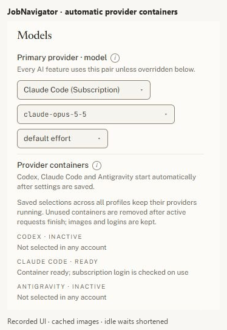

# Subscription CLI runners

Codex, Claude Code and Antigravity run in separate images. The backend resolves
account/model/credential policies and proxies subscription completions through a
private runner manager. Only that small controller receives the Docker socket;
neither the backend nor the runners do. No runner port is published on the host.
Its authenticated API accepts three provider identifiers, never arbitrary Docker
commands, image names, mounts or host paths. Install administrators must trust
the controller image: access to the Docker socket is privileged.

| Provider in Settings | Compose service | Manual profile |
| --- | --- | --- |
| Codex CLI | `codex-runner` | `codex` |
| Claude Code | `claude-runner` | `claude` |
| Antigravity CLI | `antigravity-runner` | `antigravity` |

API providers, including OpenCode Go, require none of these images. Ollama and
LM Studio remain external HTTP servers at the configured addresses; the manager
does not install, start, stop or delete them.

## Automatic lifecycle (default in Compose)

Leave `COMPOSE_PROFILES` unset. Saving a subscription provider downloads its image
if absent, creates the container and waits for readiness in the background.
Settings › Models shows downloading bytes, starting, ready, finishing requests,
inactive and errors. Ready means the service can accept requests; subscription
login is checked on use. A call before readiness fails promptly so scoring can
use its configured fallback. Unknown execution outcomes are never replayed.

The required set is the union of effective Primary, Scoring, Scoring fallback,
Tailoring, Cover letters, Autofill and Email providers across every account.
Existing Own/Inherit rules resolve those values. Empty/disabled overrides and
catalog-only entries do not require runners. Selecting two providers in different
profiles keeps both running. There is no idle timer.

When no account selects a provider, no new requests are accepted for it. Existing
calls finish before its container is stopped and removed. Images, auth volumes
and settings tokens remain; re-selection reuses them. The controller also checks
active calls after its own restart. If a running runner cannot report activity,
removal waits at least its maximum call duration plus a grace period. Settings
and policy changes wake reconciliation; a three-second backend poll also captures
account creation/deletion. The controller checks Docker every two seconds and
does not remove anything before its first complete settings snapshot.

Only the owner sees all container states and can retry provisioning. Members see
only their effective providers. The controller receives no profile list or DB
access. Completion requests carry the resolved account ID and selected Claude
OAuth token, under the same policy as before.



Recorded with cached images; static waits are shortened. The sequence shows
Codex, Antigravity and Claude Code becoming ready while the previous runner
becomes inactive. [Still screenshot](runner-containers.jpg).

## Install / update

For a published release, run `docker compose pull` then `docker compose up -d`.
Only core images, including the manager, are pulled initially. A missing runner
image is downloaded on selection. All images use `JN_IMAGE_TAG` (default latest).
Dropdown changes do not refresh cached image tags. To update cached runners,
pull/build them and recreate their containers after current work finishes:

```sh
docker compose --profile llm pull
docker compose --profile llm stop codex-runner claude-runner antigravity-runner
docker compose --profile llm rm -f codex-runner claude-runner antigravity-runner
docker compose up -d
```

The controller recreates selected containers. These maintenance commands do not
wait for application requests: let work finish first. Never use `down -v` for an
update. To stop the whole stack including managed runners, use
`docker compose --profile llm down` without `-v`.

For an unreleased source checkout, build the needed runners before selecting
them (they may not yet exist on GHCR):

```sh
docker compose build codex-runner claude-runner antigravity-runner
docker compose up --build -d
```

You can build only one. Building others does not start them. The manager uses the
actual Compose project name, its `llm` network and existing volumes. Keep the same
project name across migration to retain logins. For another registry, configure
`JN_RUNNER_IMAGE_PREFIX` (trusted install variable): runner names become
`<prefix>-codex-runner:<JN_IMAGE_TAG>` and equivalents. Source builds normally use
Compose's GHCR names, found locally without pulling.

## Existing logins and migration

Finish current work, remove `COMPOSE_PROFILES` from `.env`, and stop/remove old
manually started runner containers without deleting volumes. Pull/build the new
backend, manager and selected runners together, then start the core. Old images
without `/v1/status` are reported as incompatible rather than stopped while they
might be executing a request.

`codex_auth` keeps `/root/.codex`, `antigravity_auth` keeps `/root/.gemini`, and
`claude_accounts` keeps `/root/.claude-accounts`. Existing account subfolders and
owner/inherited paths are preserved. Backend mounts allow account deletion to
remove only that account's login even when its runner is absent. Claude tokens
remain in Settings or the backend environment with the existing policy.

Temporary login containers share these volumes and do not change requirements:

```sh
docker compose run --rm -it codex-runner codex login --device-auth
docker compose run --rm -it claude-runner claude setup-token
docker compose run --rm -it antigravity-runner agy
```

For a member's Own login, run
`docker compose exec backend python -m backend.scripts.cli_login <codex|agy|claude> "<account name>"`
to get the precise command. Paste a Claude setup token into that account's Models
setting. CLI environments contain runtime/proxy settings and the selected login
only. Claude tools are disabled, Codex uses an empty read-only workspace, and
Antigravity denies tools and deletes per-call transcripts.

## Errors and manual fallback

Failed downloads (unpublished tag, registry/network failure, full disk) and
failed starts appear in Models. Retries back off from 30 to 240 seconds; the
owner can choose Retry container setup immediately. Controller failures show
Waiting. Check `docker compose logs --tail=100 runner-manager` and runner logs.
A ready runner without a login returns login instructions on use.

For manual management set `JN_RUNNER_MANAGEMENT=0`, run `docker compose up -d`
to apply it to both the backend and manager, enable
any subset of `COMPOSE_PROFILES=codex,claude,antigravity` (or `llm` for all), then
pull/build and start those services. The backend calls them directly. Do not mix
manual profiles with automatic mode: another `compose up` could restart unused
services. The idle manager can also be stopped in manual mode.

Outside Compose, management defaults off. Direct URLs can be overridden with
`JN_CODEX_RUNNER_URL`, `JN_CLAUDE_RUNNER_URL`, `JN_ANTIGRAVITY_RUNNER_URL`.
Custom managed deployments set `JN_RUNNER_MANAGEMENT=1`, `JN_RUNNER_MANAGER_URL`
and the manager's `JN_COMPOSE_PROJECT`, image prefix/tag and matching resources.
Both sides share `JN_RUNNER_TOKEN_FILE` (default `/run/jobnavigator-runner/token`).
Use trusted private endpoints only.

On small hosts, `JN_RUNNER_MEMORY_MB` caps each automatically created runner
(0, the default, means unlimited; otherwise 64..65536 MiB). Managed runners with
a cap cannot consume swap. The controller itself can use a normal Compose
`mem_limit`. Manual-profile services use their own Compose resource settings.

A selected runner that gets no call for `JN_RUNNER_IDLE_MINUTES` (default 10) is
stopped and shows **Sleeping**: its container and logins stay, so the next call
starts it again and waits until it is ready (a few seconds). The CLI itself runs
only during a call, so an idle runner holds only its small server; stopping it
frees that too. `0` keeps selected runners running. Manual-profile services are
never stopped.

## Verification

With local images tagged `jobnavigator-<service>:local`, run:

```sh
python tests/tools/runner_smoke.py
python tests/tools/runner_management_smoke.py
```

CI builds all images and runs both. The lifecycle check substitutes Codex only
inside a disposable container, executes two real subprocesses, restarts the
controller during execution, and checks draining, deletion, retained images/auth
and recreation. Both scripts use random test resources and no user credentials.
